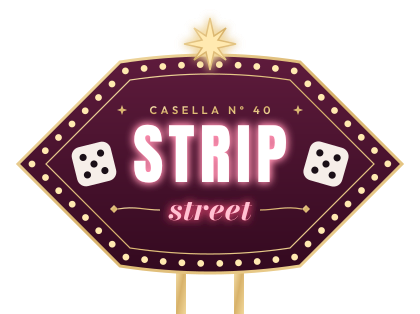

<p align="center">
  
</p>

<p align="center"><strong>Il gioco da tavolo per coppie.</strong> Solo per adulti consenzienti (18+).</p>

<p align="center"><a href="https://stripstreet.federicogamberini.it">stripstreet.federicogamberini.it</a></p>

---

Strip Street è un gioco da tavolo in stile "compra le proprietà" pensato per due giocatori. Al posto degli hotel ci sono sfide: chi capita su una proprietà del partner la esegue invece di pagare l'affitto. Quando i soldi finiscono si pagano i debiti con gli indumenti; chi non ha più né soldi né vestiti va in bancarotta e perde.

Si gioca nel browser, su un solo dispositivo condiviso, oppure si stampa la versione cartacea.

## Come si gioca

- **Partenza:** ognuno indica quanti indumenti indossa e riceve 1500€ (la cifra si può cambiare all'avvio o nelle impostazioni).
- **Turno:** si tirano i dadi e si avanza sul tabellone di 40 caselle, diviso in quattro lati sempre più intensi (Partenza & Atmosfera, Contatto & Sensualità, Provocazione & Gioco, Alta Intensità & Gran Finale).
- **Proprietà libera:** se la compri, la sfida la esegue il partner.
- **Proprietà del partner:** esegui tu la sfida al posto dell'affitto. Nelle impostazioni si può scegliere di pagare solo l'affitto, oppure affitto e sfida. Con tutto il gruppo di colore affitto e durata raddoppiano.
- **Stanze** (Divano, Cucina, Doccia…): chi le possiede può spostarci qualsiasi sfida. Si possono disattivare nelle impostazioni: diventano caselle Attività.
- **Attività, tasse, bonus:** carte e caselle speciali che esegue chi ci arriva.
- **Prigione:** niente contatto con il partner. Si esce pagando 50€, con un bacio di 15 secondi o con la carta apposita.
- **Debiti:** senza soldi, ogni 50€ mancanti si toglie un indumento.

Il regolamento completo è nella pagina **Guida** dell'app. Le caselle e le carte sono elencate in **Caselle** e **Carte**.

## Funzioni

- Tabellone interattivo con dadi, pedine, mazzi di carte e cronaca della partita
- Timer per le sfide a tempo, con preset rapidi nelle impostazioni
- Zoom sul lato del giocatore di turno ed effetti sonori regolabili
- Layout per desktop e telefono, installabile come app (Aggiungi a Home) a schermo intero
- Versione stampabile: tabellone A3, carte A4 e guida in [`doc/`](doc)

## Sviluppo

Serve Node.js 20 o superiore.

```bash
npm install
npm run dev      # server di sviluppo Vite su http://localhost:5173
npm test         # test del motore di gioco (node --test)
npm run build    # build di produzione in dist/
```

### Rigenerare i PDF stampabili

Con il server di sviluppo acceso:

```bash
npm run pdf
```

Lo script usa Edge o Chrome headless. Su macOS e Linux indicare il browser con `BROWSER=/percorso/del/browser npm run pdf`.

### Rigenerare la guida

```bash
npm run guida
```

Scrive `doc/guida.md` e `doc/guida.pdf` (A4) leggendo regole, caselle e carte da `src/data.js`. Non serve il server di sviluppo; usa Chrome o Edge come lo script dei PDF.

### Rigenerare il marchio

```bash
python brand/build.py
```

Converte le scritte in tracciati con il font Lilita One e scrive `brand/export/*.svg`, `public/favicon.svg` e `public/icona-app.svg`. Il manuale del marchio è `brand/brand-board.html`.

## Struttura

| Percorso | Contenuto |
| --- | --- |
| `src/data.js` | Tabellone, prezzi, affitti e regole: l'unica fonte dei contenuti |
| `src/cards.js` | Carte Attività e Proprietà |
| `src/game.js` | Motore di gioco (turni, acquisti, affitti, prigione, bancarotta) |
| `src/ui.js`, `src/pages.js` | Interfaccia del tabellone e sottopagine Caselle, Carte, Guida |
| `src/print.js`, `src/print.css`, `print.html` | Fogli da stampare |
| `brand/` | Marchio, font e manuale |
| `public/` | Icone, favicon e manifest dell'app |
| `test/` | Test del motore |

Per cambiare testi, prezzi o sfide si modifica solo `src/data.js` (e `src/cards.js` per le carte): il motore non va toccato.

## Deploy

Il sito è su Vercel, collegato a questo repository: ogni push su `main` pubblica in produzione su [stripstreet.federicogamberini.it](https://stripstreet.federicogamberini.it).

## Crediti

Font [Lilita One](https://fonts.google.com/specimen/Lilita+One) (SIL Open Font License, vedi `brand/fonts/OFL-LilitaOne.txt`) e Inter. Icone [Lucide](https://lucide.dev).
